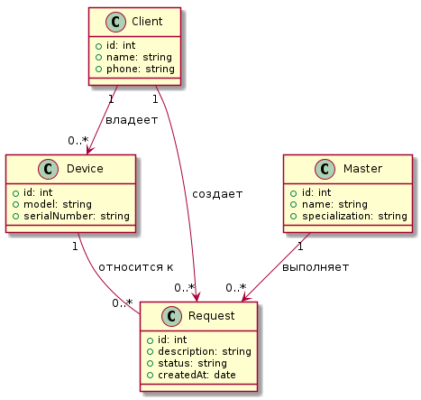
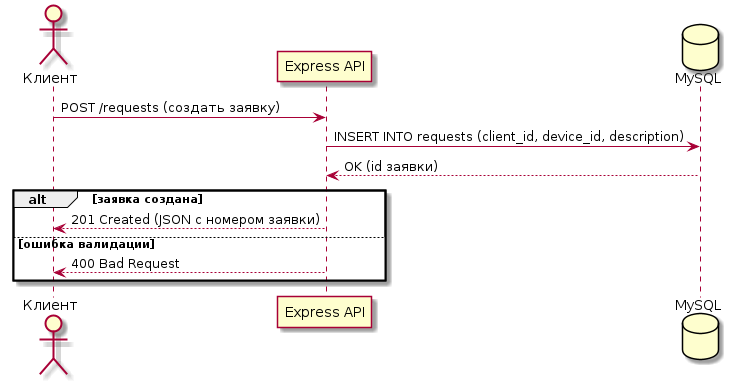

## Запуск
1. Установите зависимости: `npm install`
2. Запустите сервер: `npm start`
## Описание
Сервис для учета заявок на ремонт техники.
## Структура проекта
- src/ - исходный код
- tools/ - вспомогательные скрипты
## Использование
Пример запроса: `curl http://localhost:3000/health`
## Использование
Пример запроса: curl http://localhost:3000/health
## Практика 8 (Julia)
Выполнены задания практики 8.
## Диаграммы

### Варианты использования

### Классы

### Последовательность

